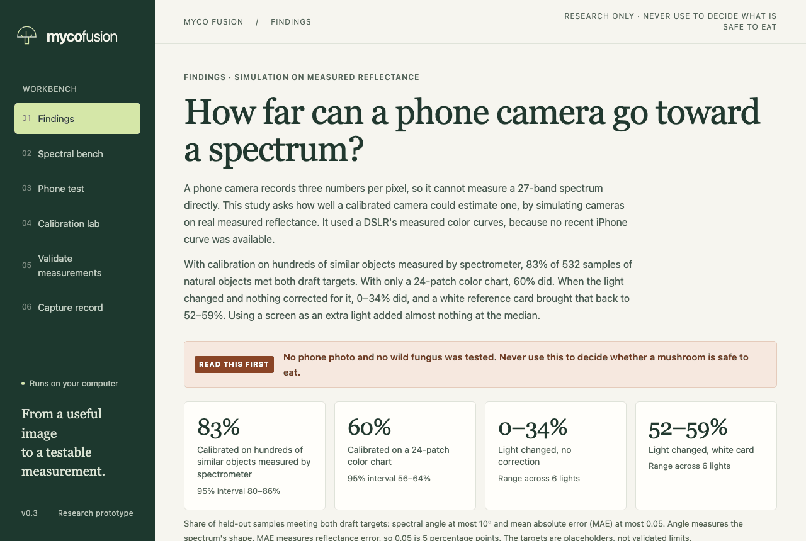
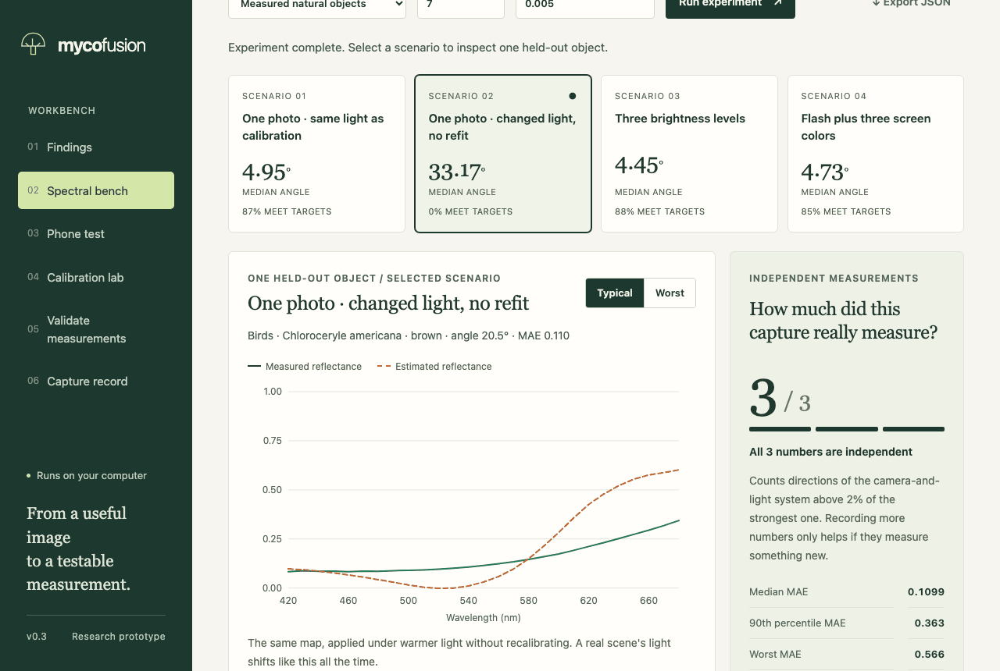
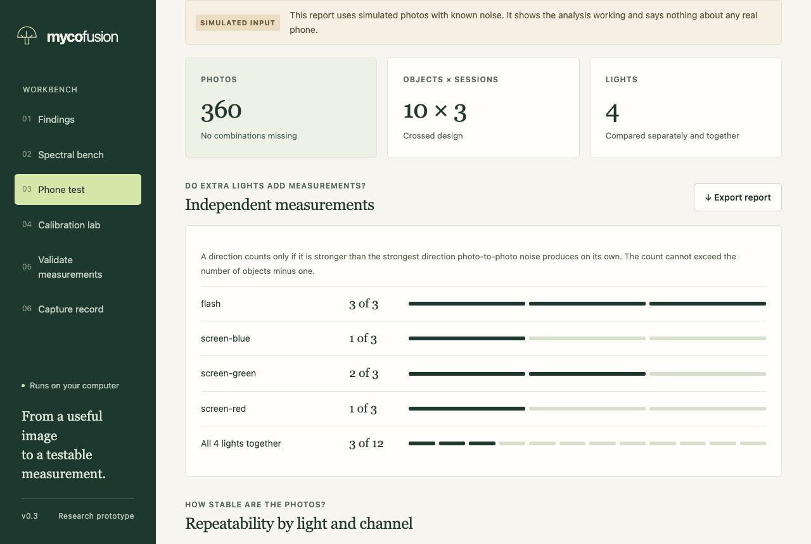

# myco-fusion

**How far can a phone camera go toward a spectrum?** A research workbench you run on your own computer, and a reproducible study on measured spectra.

> **Never use this to decide whether a mushroom is safe to eat.** It does not identify species or determine edibility. No phone photo and no wild fungus was tested.



**[Read the findings](https://patrickiben.github.io/myco-fusion/)** · [Findings as text](docs/FINDINGS.md) · [Test your own phone](docs/PHONE_TEST.md) · [Study plan](study/PLAN.md) · [Data sources](docs/DATA.md) · [Related work](docs/RELATED_WORK.md)

## The short answer

A phone camera records three numbers per pixel, so it cannot measure a 27-band spectrum directly. This study asks how well a calibrated camera could estimate one, by simulating cameras on real measured reflectance. It used a DSLR's measured color curves, because no recent iPhone curve was available.

The test set is 532 samples of natural objects. The table shows the share meeting both draft targets when held out (spectral angle at most 10°, mean absolute error at most 0.05). The targets are placeholders, not validated limits.

| Condition | Share meeting both targets |
|---|---|
| Calibrated on hundreds of similar objects measured by spectrometer | 83% |
| Calibrated on a 24-patch color chart | 60% |
| Light changed, no correction | 0–34% |
| Light changed, white card | 52–59% |

Other findings:

- **Measured spectra are harder than generated ones.** The app's first demo reported a median angle of 2.25° because it tested spectra made by the same model its solver assumes. On measured natural objects the figure is 5.28°, and the worst sample reaches 28°.
- **Using a screen as extra light added almost nothing at the median.** Adding screen colors to the flash changed median error by 0% (95% interval −3 to 2), though 90th percentile error fell from 0.037 to 0.028. The idea looked much better until a review caught that screen light had been simulated too strong.
- **The camera's color curves matter.** Swapping one camera's measured curves for another's moved the share meeting both targets from 83% to 56%.
- **A color chart transfers unevenly.** On leaves, chart-only calibration gave 3.8 times the error of a calibration on leaves.
- **The mushroom data can't answer the mushroom question.** The only public set found covers 250 samples of an unnamed species, and their spectra barely change shape.

These are simulations. Real results should be expected to be worse, because clipping, tone mapping, uneven light and gloss are left out.

## Run the app

Needs Python 3.11 or newer.

```bash
git clone https://github.com/patrickiben/myco-fusion
```

```bash
cd myco-fusion && python3 -m venv .venv && .venv/bin/pip install .
```

```bash
.venv/bin/myco-fusion serve --open
```

The server binds only to your own machine, and photos and files stay there. On a Mac, you can also double-click `Launch Myco Fusion.command` from a source checkout.

| Tab | What it does |
|---|---|
| **Findings** | The study's results, with every chart available as a table |
| **Spectral bench** | Four ways of taking the photo on measured spectra, and two real samples that look alike under flash |
| **Phone test** | Measures how stable your phone's photos are, and checks whether extra lights add independent measurements. Includes a full-screen light panel and a tool that measures a box in your photos. Nothing to buy. Not yet tried on real iPhone photos |
| **Calibration lab** | Fits RGB to reflectance with checks that stop specimens or sessions leaking across splits. Real use needs a spectrometer |
| **Validate measurements** | Scores paired spectra with intervals that state their true confidence level |
| **Capture record** | Draft records that keep each capture traceable |





## Reproduce the study

```bash
.venv/bin/pip install ".[study]" && .venv/bin/python -m study
```

This downloads the measured data, checks its hashes, and rebuilds `results/`, `docs/FINDINGS.md`, `docs/PHONE_TEST.md` and `site/` in a few minutes. A rerun reproduces `results/study.json` byte for byte on the same setup. Numbers in the text come from the results, and the build stops if a rerun no longer supports the main written claims.

The plan in [study/PLAN.md](study/PLAN.md) was written before the natural-object and mushroom results were computed. It has no independent timestamp. A separate AI code review of the first full run found real errors, and every change made after that run is listed at the end of the plan. No human expert has reviewed this work yet.

Run the tests with `.venv/bin/python -m unittest discover -s tests`. A real-browser check of every tab is in `tools/browser_check.py`.

## What is and isn't here

- **Here:** the study, a tested numerical core with NumPy as its only dependency, and the app.
- **Not here:** native iPhone capture, RAW decoding, a 3D Gaussian splatting engine, continual learning, species classification, or any physical validation. The original idea included 3D capture; only a tested point-projection function exists (`myco_fusion/geometry.py`).

The next useful steps are the [phone test](docs/PHONE_TEST.md), repeating the study with a measured iPhone sensitivity curve, and pairing phone photos with spectrometer readings using the [capture protocol](docs/CAPTURE_PROTOCOL.md).

## Credits and license

Built with AI coding assistants: started in OpenAI Codex and continued in Claude Code. Author: Patrick Iben.

Code is under the [MIT License](LICENSE). The bundled natural-object table, `myco_fusion/data/natural_objects_27band.csv`, is derived from CC BY 4.0 data, and its [notice](myco_fusion/data/NOTICE.txt) applies instead. See [docs/DATA.md](docs/DATA.md) for every source. To cite this work, see [CITATION.cff](CITATION.cff).
